# API Onboarding Automation: Postman CSE Exercise

This repo turns an OpenAPI spec into a cataloged, testable API in Postman with a single
workflow run. The working implementation onboards the **payment-refund** service. The
**claims** service is covered as a design analysis in
[docs/adaptation-claims.md](docs/adaptation-claims.md).

| | |
|---|---|
| Postman workspace | [payment-refund-api](https://go.postman.co/workspace/a254fb2a-b82a-4f97-8d95-99cdeadb5be3) |
| First onboarding run | [44354380990](https://github.com/dini-rockz93/cse-exercise-solution/actions/runs/44354380990): created everything, 1m 34s |
| Rerun | [44356679969](https://github.com/dini-rockz93/cse-exercise-solution/actions/runs/44356679969): reused everything, 47s |
| Secrets preflight | [44354145064](https://github.com/dini-rockz93/cse-exercise-solution/actions/runs/44354145064) |

> **Drafting note:** this README and the adaptation analysis were drafted with Claude
> from the build session, then reviewed and edited by me. See [How I used AI](#how-i-used-ai).

---

## What one run produces

From `specs/payment-refund-api-openapi.yaml`, the [Onboard Service](.github/workflows/onboard-service.yml) workflow creates:

- **Workspace** `payment-refund-api`, owned by a service account (`ci-onboarding`), not a person
- **Spec in Spec Hub**, linked to the generated collections
- **Three collections:** baseline (`payment-refund-api`), `[Smoke]` and `[Contract]`
- **Four environments** (dev, qa, uat, prod), each with the correct `baseUrl` from the spec's `servers`
- **A mock server** that serves the spec's examples (base path includes `/v2`)
- **A smoke monitor**, created paused, triggered once per run, pointed at prod (re-pointed to the mock for the demo)
- **A commit back to this repo** with collection exports (`postman/`), the state file
  (`.postman/resources.yaml`) and a CI workflow (`.github/workflows/ci.yml`)

| Run summary (GitHub) | Resulting workspace (Postman) |
|---|---|
| 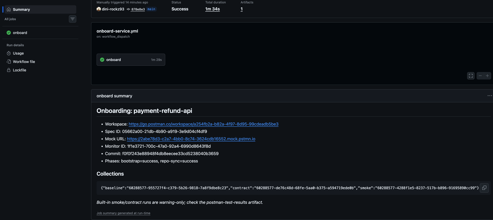 | 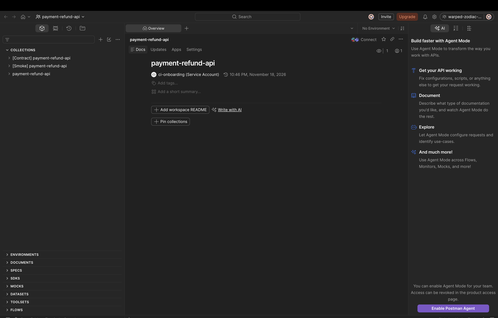 |

## How it works

```
workflow_dispatch (service name, spec path, environments, URLs)
   │
   ├─ Preflight ............ spec exists, raw URL fetchable, JSON inputs valid
   ├─ Mint access token .... postman-resolve-service-token-action (from the service-account key)
   └─ Onboard .............. postman-api-onboarding-action@v4.1.0
         ├─ bootstrap ...... workspace, Spec Hub upload, baseline/smoke/contract collections
         ├─ repo-sync ...... environments, mock, monitor, exports, state file, commit + push
         └─ built-in tests . smoke + contract via Postman CLI (warning-only, JUnit artifact)

push to main ──► ci.yml ── smoke + contract tests (against the mock while CI_TARGET=mock)
```

**On rerun**, bootstrap reads `.postman/resources.yaml` and updates the existing assets in
place. The rerun log shows *"Using existing workspace"*, *"Deep-updated existing
baseline/smoke/contract collection"* and *"Discovered existing mock … existing
monitor"*, with the same IDs as run 1 and no duplicates.

## Decisions I made

### I bypassed the starter asset instead of fixing it in place

`starter-assets/` is kept for reference, but the workflow calls the upstream actions
directly. The starter had three problems:

1. **`spec-url: ${{ inputs.spec-path }}`.** It passes a repo-relative path where an
   HTTPS URL is required.
2. **It's pinned to `@v0`**, while the current release is `v4.1.0`. I pinned the
   immutable `v4.1.0` tag for reproducibility.
3. **It writes with `github.token`.** The default token can't push changes under
   `.github/workflows/`, and repo-sync commits a generated `ci.yml`. I used a
   fine-grained PAT (`GH_PAT`).

A wrapper composite action adds a layer without adding behavior, so calling the action
directly is easier to read and debug.

### A service-account access token, minted per run

The brief suggests a `postman login` session token. That token expires and is tied to
a person, so it fails silently later. I mint a fresh token per run from a
**service-account** API key (`postman-resolve-service-token-action`). The
`POSTMAN_ACCESS_TOKEN` secret is still wired as a fallback. `credential-preflight: enforce`
makes the run fail *before* creating anything if the key and the token belong to
different orgs.

### Other choices

- **Spec URL pinned to the commit SHA**, so the run onboards exactly the spec in the
  triggering commit, not whatever `main` is by the time the runner fetches it.
- **`concurrency: onboard-<service>`**, so two dispatches for the same service can't race
  and create duplicate workspaces.
- **Preflight step**, so bad inputs fail in seconds with a clear message instead of
  deep inside the action.
- **A [Check secrets](.github/workflows/check-secrets.yml) workflow** that verifies the
  secrets as Actions actually sees them. It's the first thing to run when onboarding a
  new repo.
- **I own `ci.yml` after the first generation.** Onboarding now runs with
  `generate-ci-workflow: 'false'`, otherwise every rerun would overwrite my changes (see
  below).

## Universal vs per-service

| Universal (identical for every service) | Per service (workflow inputs) |
|---|---|
| Token minting, preflight, onboarding action and version | `project_name` |
| Workspace / Spec Hub / collections / mock / monitor creation | `spec_path` |
| State file, rerun-safe updates | `domain` |
| CI test job structure | `environments_json`, e.g. `["dev","qa","uat","prod"]` |
| Secrets and their scopes | `env_runtime_urls_json`, the base URL per environment |
| | CI credential for the service's auth scheme (not wired yet) |

Onboarding the next GitHub service means **one dispatch with five different inputs**.
Claims shows what changes when the CI system is different:
[docs/adaptation-claims.md](docs/adaptation-claims.md).

## What the generated tests prove, and where they stop

Contract collection results from this repo's runs (Postman → `[Contract]` → Runs):

| Run | Target | Tests | Passed | Failed |
|---|---|---|---|---|
| Build 1, Build 2 | Real URLs (`*.example.com`, which don't resolve) | 208 | 195 | 13 |
| Build 4 | Mock | 208 | 201 | 7 |
| After the spec fixes (`9d98ad9`) | Mock | 207 | 202 | **5**, all "no credentials" |

13 → 7 → 5: the mock removed the "no response" failures, the spec fixes removed the two
real defects, and what's left is the one thing only the customer can provide, a CI identity.

The fix loop as it ran: spec-fix commit → onboarding re-run (40s, assets updated in place)
→ sync commit → CI against the regenerated collections:

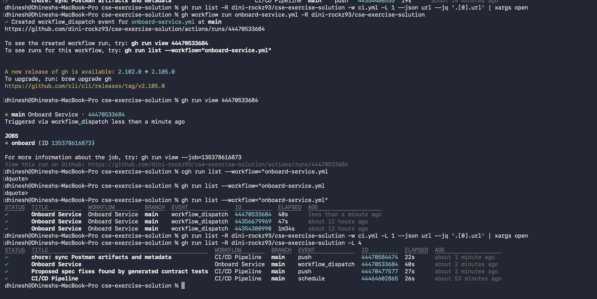

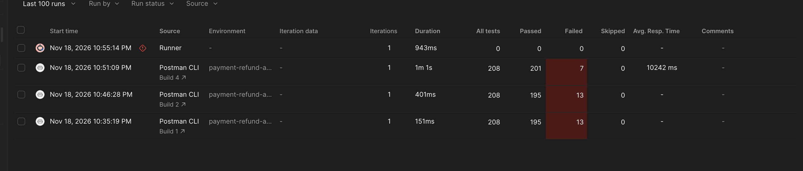

**A pass count alone proves nothing.** 195 of 208 assertions "passed" when not a single
request reached a server. Many generated assertions only apply *if* a matching response
arrives, so with no response they pass without checking anything. Check what failed and
whether requests got responses, not just the totals.

**What they establish immediately, from the spec alone:**
- Every operation is callable with the right method, path, parameters and an example body.
- Response status, schema and headers are checked against the spec.
- Security requirements are enforced. Every request is checked for credentials matching
  the spec's `security`.
- **They found two real spec defects on day one**, both fixed in commit `9d98ad9`
  ("Proposed spec fixes…", which would be a PR to the payments team) and confirmed by the
  next contract run:
  1. `POST /refunds` example `full_refund` sends `amount: null`, but `amount` is a
     non-nullable `integer`. The description says to *omit* it for a full refund. Anyone
     copying the docs example gets a validation error.
  2. `GET /health` has no `security: []`, so it inherits OAuth/JWT. Health checks are
     normally public, and the claims and loan specs both set `security: []` here.
- Onboarding also produced static warnings: 401 responses don't declare
  `WWW-Authenticate`, and examples don't match their schemas.

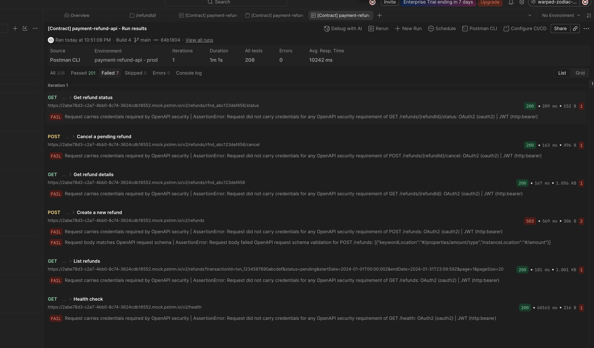

**Where they stop (needs service-specific knowledge):**
- **Credentials.** The spec says *how* the API is secured, not how a CI runner gets a
  token. Payment refund's OAuth uses the **authorization code** flow, which needs a
  browser login and can't run unattended. CI needs the JWT path or a client-credentials
  client, with a least-privilege scope. The generated config requests
  `refunds:read refunds:write refunds:admin`, and a smoke test shouldn't hold `admin`.
- **Business logic.** "Can't cancel a completed refund" or "a refund can't exceed the
  capture" aren't in the schema, so they aren't tested.
- **Test data and ordering.** Real IDs, seeded transactions, and create-then-read flows
  across requests.
- **Side effects.** Smoke tests that `POST` create real refunds. That's safe on the mock,
  not on prod.

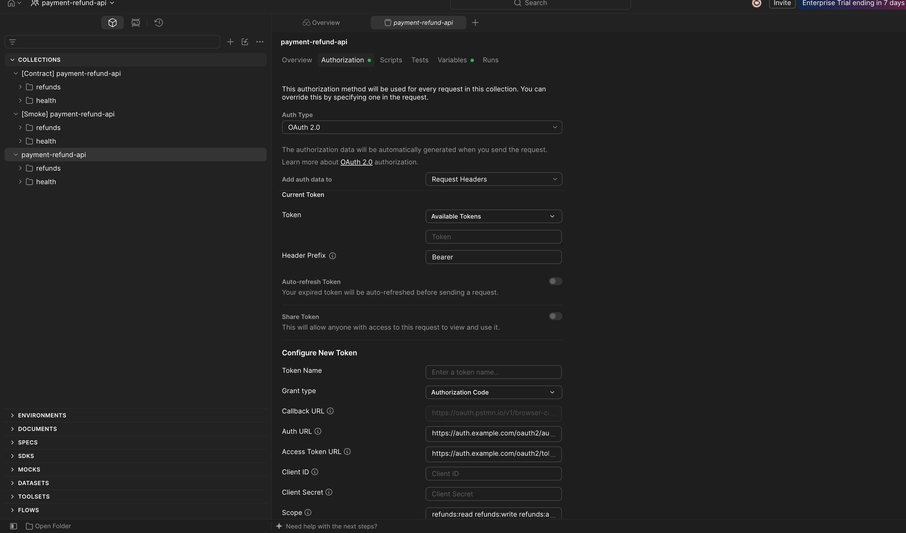

## What the customer's platform team must provide

| Need | Why | Without it |
|---|---|---|
| Reachable base URLs per environment (API Gateway stage / ALB) | Tests and monitors hit real services | Tests run against the mock only |
| A CI identity per service (JWT issuer or OAuth client credentials), least-privilege, non-prod | Authenticated contract tests | The 5 remaining contract failures stay |
| Postman **service account** and API key; workspace-creation policy allowing it | Onboarding creates workspaces unattended | Bootstrap fails, since it can't approve its own request |
| GitHub: fine-grained token or **GitHub App** (Contents, Variables, Workflows: write) | Commit exports and state back to repos | Repo-sync fails at commit time |
| GitLab (claims group): project access token, runner with egress to Postman/npm | Same pattern on GitLab CI | No onboarding for that group |
| Network egress from runners to `*.getpostman.com`, `dl-cli.pstmn.io` | CLI install and API calls | Nothing runs |
| Spec owners per service | Fix defects the tests find | Same failures every run, and people stop reading them |

## Run it

**Prerequisites:** Postman Enterprise (trial is fine), a service account with workspace
creation allowed, and these repo secrets:

| Secret | Value |
|---|---|
| `POSTMAN_API_KEY` | Service-account Postman API key |
| `GH_PAT` | Fine-grained token for this repo: Actions, Contents, Variables, Workflows = read and write |
| `POSTMAN_ACCESS_TOKEN` | *(optional fallback)* from `postman login` |

```bash
gh workflow run check-secrets.yml          # 1. verify secrets
gh workflow run onboard-service.yml        # 2. onboard (defaults = payment-refund)
gh workflow run onboard-service.yml \
  -f project_name=my-service -f spec_path=specs/my-service.yaml \
  -f environments_json='["dev","prod"]' \
  -f env_runtime_urls_json='{"dev":"https://...","prod":"https://..."}'   # another service
```

**CI test target** (repository variables):

| `CI_TARGET` | Behavior |
|---|---|
| `mock` (current) | Tests run against `POSTMAN_MOCK_URL`; failures are advisory (visible, non-blocking). **A failed test step still shows a green check** because of `continue-on-error`; the failures are only visible in the run's **Annotations** ("exit code 1") |
| unset | Tests run against each environment's real `baseUrl`; failures block |

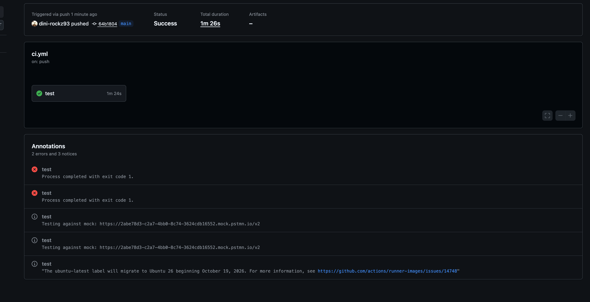

## Validation notes

- **Checked the artifacts, not just the job status.** I looked at the workspace,
  collections, environments, spec, contract run results, mock server and smoke monitor in
  Postman, the commit and state file in the repo, and called the mock (`GET /v2/refunds`
  returns the example refund).
- **The monitor exists and is paused:** `payment-refund-api - Smoke Monitor` has 2 runs,
  one triggered per onboarding run.
- **Rerun-safe:** the second run reused all asset IDs. Postman shows exactly 3
  collections and 4 environments after two runs.
- **Credentials verified in Actions itself**, not just locally (Check secrets workflow).
- **Workflows linted** with `actionlint`.

## Issues I hit and how I resolved them

| Issue | Symptom | Cause | Resolution |
|---|---|---|---|
| Testing the API key | `/me` returned `null` fields | The shell variable was empty, not a bad key | Tested in a real terminal with a hidden prompt |
| GitHub token couldn't write | `200` on reads, `403` on every write | Fine-grained token had **zero** repository permissions; reads passed only because the repo is public | Added Actions, Contents, Variables, Workflows = write; verified with a `422` probe (authorized, invalid body) |
| Generated CI always red | `ENOTFOUND api.payments.example.com` after every sync commit | `ci.yml` tests the prod environment, whose host doesn't exist | `CI_TARGET=mock` switch; took ownership of `ci.yml` so reruns don't overwrite it |
| Create-refund failing on the mock | `POST /refunds` → `503` | That endpoint has 9 response examples, and the mock returned the 503 one | Made mock-mode tests advisory. The real fix is real environments, plus fixing the request example |
| Two spec defects | Contract: `amount` schema failure; `/health` asks for credentials | `amount: null` in the example; `/health` missing `security: []` | Fixed the spec (`9d98ad9`) and re-onboarded: 7 → 5 failures |
| Monitor sent requests to `http://refunds/...` | 18 failures, 6 connection errors | The new environment's `baseUrl` was saved as a **local** value. Monitors run in Postman's cloud and only see **shared** values | Shared the value (☁ Share), and the monitor then reached the mock: 17 of 18 |
| Preflight log noise | `curl: (23) Failure writing output` | `head -1` closed the pipe early | Download to a file, then check it |

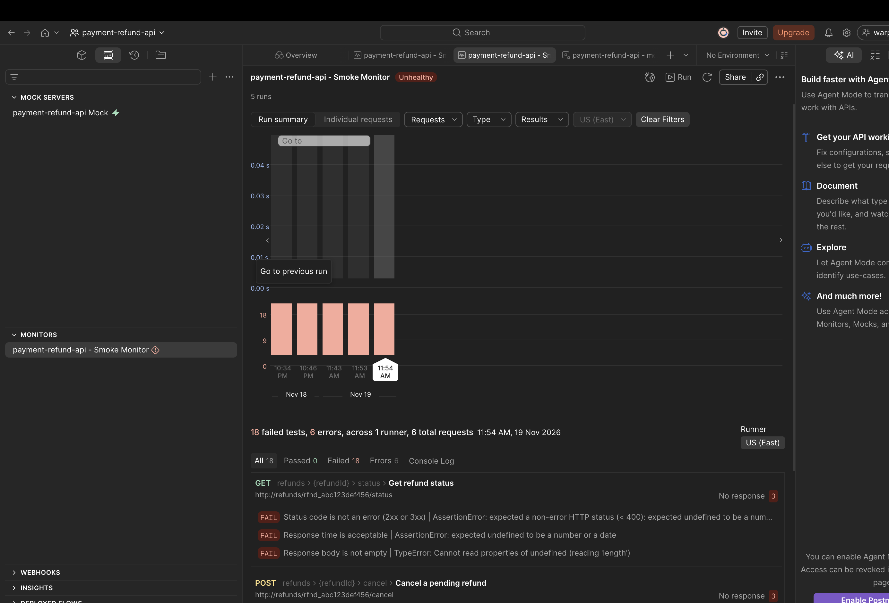

| Token as first created (0 permissions) | After the fix |
|---|---|
| 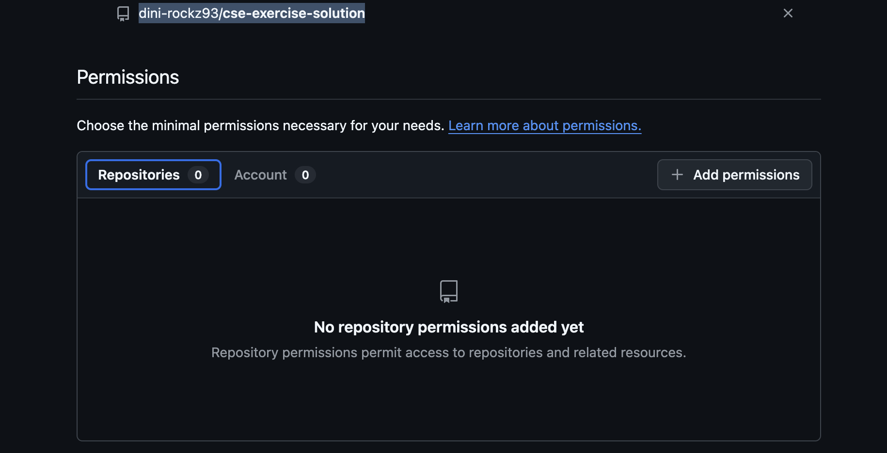 | 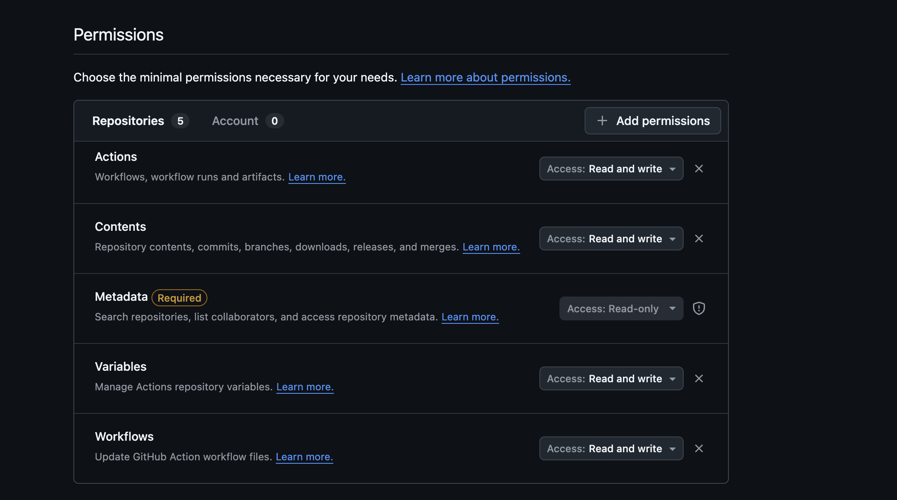 |

## Known limitations and trade-offs

- **Noise commits.** Every onboarding run commits even if the spec didn't change, because
  regenerated auth IDs differ, and each commit triggers CI. At 50 services this is real
  noise. I'd raise it as product feedback and filter bot commits in CI meanwhile.
- **The state file grows.** Pinning `spec-url` to the commit SHA adds one key per run to
  `resources.yaml`, all mapping to the same spec. Pointing it at `main` stops this but
  loses exact reproducibility.
- **The mock can't choose between identical examples.** `POST /refunds` has 9 saved
  examples (201, 400, 401, 404, 409, 422, 429, 500, 503), and all 9 have exactly the
  same request (method, URL, body). The mock returns the `503` one, so smoke reports
  17 of 18. The `503` stayed after the spec fix, which confirms the request body isn't
  what the mock uses to pick. Fixes, in order of preference:
  1. Test against a real dev environment, where the server decides the status.
  2. Send `x-mock-response-code: 201`. This has to live in the curated smoke flow
     (`postman/flow.yaml`), because onboarding regenerates the Smoke collection on every
     run (header support in the manifest not yet verified).
  3. Not chosen: deleting the error examples or weakening the status check, which would
     turn the run green without proving anything.

  That's why mock-mode CI is advisory.
- **Flaky dependency.** One mock request took 60 s (`/health`), which pushed the
  average response time to 10 s. Monitors should alert on repeated failures, not on one.
- **The monitor needed a hand-edit to be useful.** The action creates it paused (no
  `monitor-cron`), triggers it once per onboarding run, and points it at the **prod**
  environment. Against the non-existent prod host it failed 18 of 18 with "No response".
  The `CI_TARGET=mock` switch only affects GitHub CI, not the monitor. For the demo I
  pointed it at a `payment-refund-api - mock` environment, and it now shows **17 of 18**,
  the same `POST /refunds` 503 as CI. Two caveats:
  - It's a hand-edit outside the pipeline, so a later onboarding run may reset the
    monitor to prod. That's config drift, and the real fix is a reachable environment.
  - It stays **unscheduled**. Scheduling it against a mock would report "healthy"
    without checking the real API. Schedule and alert routing are the customer's call,
    once a reachable URL and credentials exist.
- **Where to find things in Postman:** the mock server and monitor are under the second
  sidebar view (*Mock servers* / *Monitors*), not the collections view.
- **Advisory CI is a temporary state.** If `CI_TARGET=mock` is never removed, the
  pipeline is permanently "green but not checking anything real".

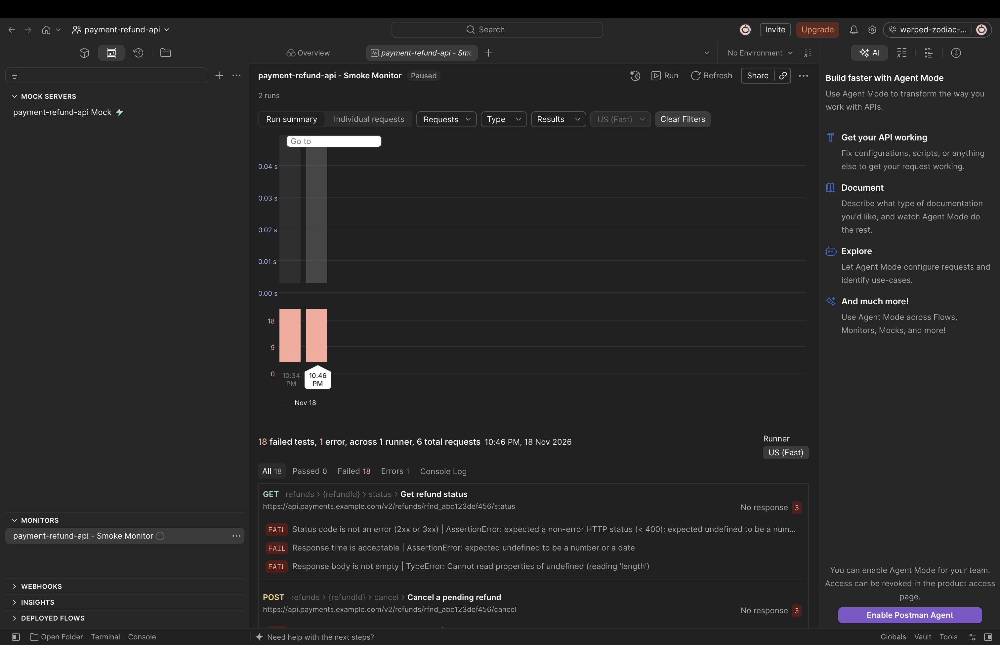

## Repo layout

```
.github/workflows/
  onboard-service.yml   # onboarding entrypoint (one dispatch per service)
  check-secrets.yml     # credentials preflight
  ci.yml                # smoke + contract tests (generated once, then owned here)
  postman-preview-gc.yml# generated by repo-sync (preview cleanup)
.postman/resources.yaml # state: Postman IDs, used to make reruns safe
postman/                # exported collections and environments
specs/                  # the three provided OpenAPI specs
docs/adaptation-claims.md
docs/screenshots/       # evidence from the real runs (see below)
starter-assets/         # original starter, kept for comparison (not used)
```

## Screenshots

All taken from the real runs on 18–19 Nov 2026.

| File | Shows |
|---|---|
| [01-workspace-overview](docs/screenshots/01-workspace-overview.png) | Workspace created by the `ci-onboarding` service account |
| [02-spec-hub](docs/screenshots/02-spec-hub.png) | Spec in Spec Hub with all four servers |
| [03-contract-failures](docs/screenshots/03-contract-failures.png) | The 7 contract failures against the mock |
| [04-environment-prod](docs/screenshots/04-environment-prod.png) | Generated `prod` environment (`baseUrl`, `RESPONSE_TIME_THRESHOLD`) |
| [05-auth-gap-oauth](docs/screenshots/05-auth-gap-oauth.png) | Auth copied from the spec: OAuth authorization code, no client credentials |
| [06-mock-response](docs/screenshots/06-mock-response.png) | `GET /v2/refunds` on the mock, with no backend running |
| [07-monitor](docs/screenshots/07-monitor.png) | Smoke monitor: 18/18 failing against prod, then 17/18 after pointing it at the mock |
| [08-onboard-run-summary](docs/screenshots/08-onboard-run-summary.png) | First onboarding run: workspace, spec, mock, monitor, commit |
| [09-ci-mock-advisory](docs/screenshots/09-ci-mock-advisory.png) | CI against the mock: green, failures visible as annotations |
| [10-contract-run-history](docs/screenshots/10-contract-run-history.png) | Contract runs: 13 failures on real URLs, 7 on the mock |
| [11-pat-no-permissions](docs/screenshots/11-pat-no-permissions.png) | GitHub token as first created, with no permissions |
| [12-pat-permissions-fixed](docs/screenshots/12-pat-permissions-fixed.png) | GitHub token with the permissions the workflow needs |
| [13-terminal-spec-fix-run-chain](docs/screenshots/13-terminal-spec-fix-run-chain.png) | Terminal: onboarding dispatched from the CLI, and the commit → onboard → sync → CI chain |
| [14-monitor-local-value-bug](docs/screenshots/14-monitor-local-value-bug.png) | Monitor hitting `http://refunds/...` while `baseUrl` was a local-only value |

## How I used AI

I used Claude Code throughout, as a pair:

- **AI drafted:** both workflow files, the `ci.yml` mock switch, the Check secrets
  workflow, the first drafts of this README and the adaptation analysis, and the
  shell commands used to verify credentials.
- **AI analysed:** the upstream action docs (it found the current version, the service
  token action and the GitLab CLI path), the specs, and the run logs.
- **I did and decided:** set up the Postman Enterprise trial, service account and
  GitHub token; ran every workflow and verification command; checked the results in
  Postman and GitHub; chose to point CI at the mock and to make it advisory rather than
  hide failures; reviewed and edited the docs.
- **Where AI was wrong or needed correcting:**
  - **Testing the API key from the chat shell.** It had me run the key check from the
    assistant's shell, where each command starts fresh, so `$PMAK` was empty and the key
    *looked* invalid (`AuthenticationError`, length 0). I re-tested in my own terminal
    with a hidden prompt, and the key was fine.
  - **Mock URL path.** Its first mock check called `/health` and got a 404. The mock
    matches the full server path, so it needs `/v2/health`. That's also a gotcha for
    consumers, and why `POSTMAN_MOCK_URL` ends in `/v2`.
  - **`gh run view --log` without a run ID** fails when not interactive. I had to look
    up the run ID first.
  - **First fix for the always-red CI.** Pointing CI at the mock removed the network
    errors, but the tests were still blocking, so one non-deterministic mock response
    (the `503` example on `POST /refunds`) kept the pipeline red. I chose to make
    mock-mode tests advisory (visible but not blocking) rather than hide or delete the
    failing check.
- **What I verified myself rather than trusting the output:** every claim about created
  assets was checked in Postman or GitHub (workspace, collections, environments, spec,
  mock, monitor, run results), and every credential was verified both locally and from
  inside GitHub Actions.
